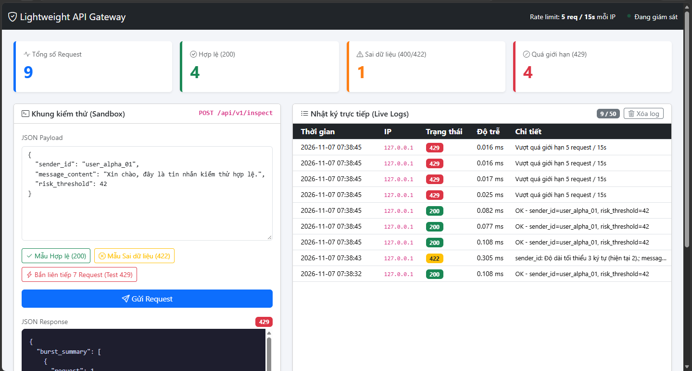

# 🛡️ Lightweight API Gateway & Request Validator

Dự án cá nhân xây dựng một lớp kiểm duyệt trung gian (API Gateway cơ bản) bằng **Python (Flask)** và **Bootstrap 5**. Mục tiêu của dự án là tự cài đặt hai cơ chế bảo vệ cơ bản cho Web Server mà không phụ thuộc vào thư viện bên thứ ba:
1. **Giới hạn tần suất gửi Request (Rate Limiting):** Chặn hành vi spam request liên tục từ một địa chỉ IP bằng cấu trúc dữ liệu hàng đợi hai đầu (`collections.deque`).
2. **Kiểm tra dữ liệu đầu vào (JSON Validation):** Đảm bảo dữ liệu JSON từ Client gửi lên đúng định dạng, đủ trường bắt buộc và đúng kiểu dữ liệu trước khi xử lý.



---

## 🔄 Luồng xử lý một HTTP Request

Khi Client gửi một `POST` request đến đường dẫn `/api/v1/inspect`, dữ liệu sẽ đi qua 3 bước kiểm tra tuần tự:

```text
[Client gửi HTTP POST Request]
       │
       ▼
Bước 1: Kiểm tra giới hạn tần suất (Rate Limiter dùng Deque)
       ├──► Nếu gửi quá 5 lần trong 15 giây ──► Trả về lỗi [HTTP 429 Too Many Requests]
       │
       ▼ (Hợp lệ)
Bước 2: Đọc dữ liệu JSON & Kiểm tra quy tắc (Schema Validator)
       ├──► Nếu cú pháp JSON bị lỗi ──────────► Trả về lỗi [HTTP 400 Bad Request]
       ├──► Nếu thiếu trường / sai kiểu ──────► Trả về lỗi [HTTP 422 Unprocessable Entity]
       │
       ▼ (Dữ liệu hợp lệ)
Bước 3: Xử lý chính & Ghi nhận lịch sử (Log)
       │
       ▼
Trả về [HTTP 200 OK] kèm kết quả JSON và thời gian xử lý (ms)
```

---

## 💡 Cách cài đặt 2 mô-đun cốt lõi (Trong file `gateway_core.py`)

### 1. Giới hạn số lần gửi Request bằng Hàng đợi hai đầu (`deque`)
Để giới hạn mỗi địa chỉ IP chỉ được gửi tối đa **5 requests trong vòng 15 giây gần nhất** (cửa sổ trượt - Sliding Window), chương trình lưu trữ thời điểm gửi (`timestamp`) của từng IP vào một `deque`:

* Khi có request mới ở thời điểm hiện tại (`now`), chương trình tính mốc giới hạn cũ: `window_start = now - 15`.
* Dùng vòng lặp `while` kiểm tra phần tử đầu hàng đợi (`timestamps[0]`). Nếu mốc thời gian đó nhỏ hơn hoặc bằng `window_start` (tức là đã qua hơn 15 giây), chương trình loại bỏ nó khỏi đầu hàng đợi bằng hàm **`popleft()`**.
* Sau khi dọn các mốc thời gian cũ, nếu số phần tử còn lại trong `deque` đã bằng 5, server sẽ từ chối request (trả về mã `429`) và báo số giây cần chờ.
* Nếu chưa đủ 5 lần, chương trình thêm `now` vào cuối hàng đợi bằng hàm **`append()`** và cho phép request đi tiếp.

> **Lý do chọn `deque`:** Thao tác xóa phần tử ở đầu (`popleft`) và thêm vào cuối (`append`) trong `deque` đều thực hiện trực tiếp với độ phức tạp $O(1)$, nhanh hơn so với dùng `list` thông thường (vì xóa đầu `list` bằng `pop(0)` phải dịch chuyển các phần tử phía sau với độ phức tạp $O(n)$).

### 2. Kiểm tra dữ liệu JSON (Schema Validator)
Sau khi chuyển đổi chuỗi JSON nhận từ mạng sang kiểu `dict` trong Python, chương trình dùng các câu lệnh điều kiện và hàm `isinstance()` để kiểm tra 3 trường dữ liệu:

| Tên trường | Kiểu dữ liệu yêu cầu | Điều kiện hợp lệ |
| :--- | :--- | :--- |
| `sender_id` | Chuỗi (`str`) | Bắt buộc có, độ dài từ `3` đến `50` ký tự |
| `message_content` | Chuỗi (`str`) | Bắt buộc có, độ dài từ `5` đến `500` ký tự |
| `risk_threshold` | Số nguyên (`int`) | Bắt buộc có, giá trị từ `1` đến `100` (không nhận kiểu `bool`) |

---

## 📋 Ý nghĩa các mã trạng thái HTTP (HTTP Status Codes)

Dự án áp dụng chuẩn mã phản hồi HTTP để thông báo kết quả rõ ràng cho Client:
* **`200 OK`**: Request hợp lệ, vượt qua cả bước kiểm tra tần suất và kiểm tra dữ liệu.
* **`400 Bad Request`**: Dữ liệu gửi lên bị lỗi cú pháp JSON (ví dụ: thiếu dấu ngoặc kép, dư dấu phẩy).
* **`422 Unprocessable Entity`**: Cú pháp JSON đúng nhưng dữ liệu bên trong sai quy định (thiếu trường bắt buộc, truyền chuỗi vào ô số nguyên, hoặc vượt quá độ dài cho phép).
* **`429 Too Many Requests`**: Người dùng gửi vượt quá 5 requests trong vòng 15 giây.

---

## 🚀 Hướng dẫn cài đặt và chạy thử

### 1. Cài đặt thư viện
Dự án sử dụng **Python 3** và micro-framework **Flask**:
```bash
pip install -r requirements.txt
```

### 2. Khởi chạy Web Server
```bash
python app.py
```
Mở trình duyệt và truy cập địa chỉ: **`http://127.0.0.1:5000`**

### 3. Các kịch bản kiểm thử trực tiếp trên giao diện Web
Trên giao diện **Bootstrap Dashboard**, có sẵn 3 nút bấm để kiểm thử nhanh:
1. **Mẫu Hợp lệ (200):** Gửi dữ liệu chuẩn, bảng nhật ký (Live Logs) ghi nhận trạng thái màu xanh lá `200`.
2. **Mẫu Sai Schema (422):** Gửi dữ liệu có `sender_id` quá ngắn và `risk_threshold` là chuỗi ký tự, server trả về danh sách lỗi chi tiết với mã vàng `422`.
3. **Spam 7 Req (Test 429):** Tự động gửi liên tiếp 7 requests để kiểm tra khả năng chặn của `deque` từ request thứ 6 trở đi (mã đỏ `429`).

---

## 📁 Cấu trúc thư mục
```text
lightweight-api-gateway/
├── app.py                  # Flask Server, định tuyến API (/api/v1/inspect) và lưu lịch sử log
├── gateway_core.py         # Cài đặt lớp SlidingWindowRateLimiter (deque) và SchemaValidator
├── templates/
│   └── dashboard.html      # Giao diện kiểm thử và bảng thống kê bằng Bootstrap 5
├── requirements.txt        # Danh sách thư viện (Flask)
└── README.md               # Tài liệu mô tả dự án
```